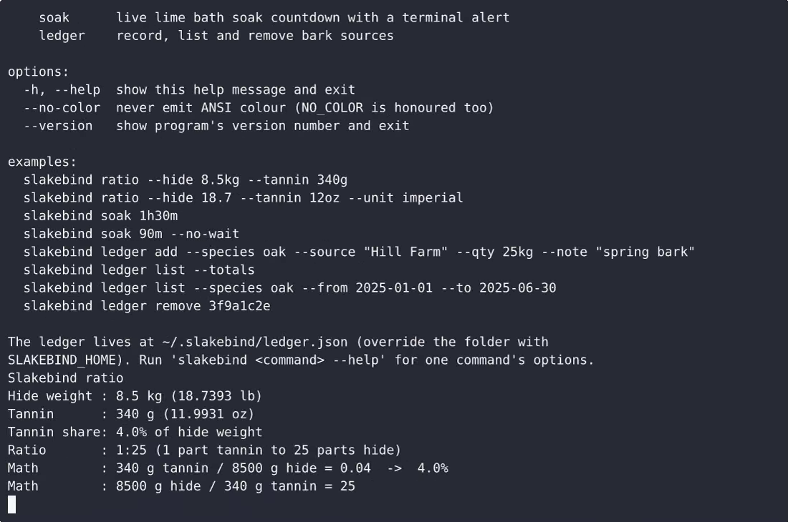
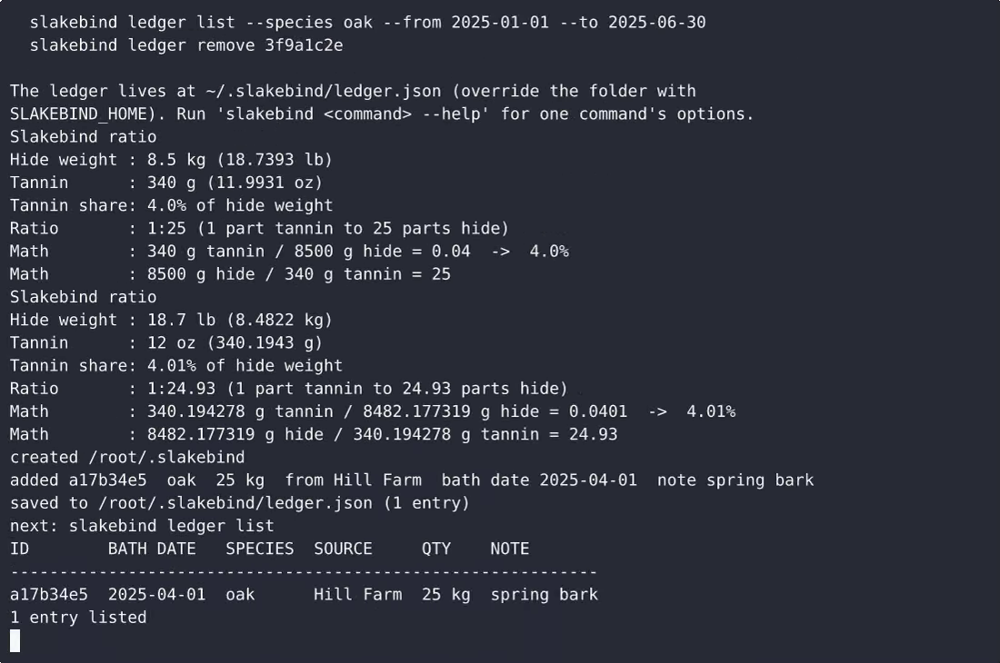

# Slakebind — complete Full-stack app command-line tool example app

Need a self-hosted command-line tool? **Slakebind** is the open-source answer: a Full-stack app project you can clone, run, and own. Slakebind is a single-file, standard-library-only Python 3 command-line tool that does three jobs for a hide tanner: it turns a hide weight plus a tannin quantity into a tannin-to-hide ratio (metric shown by default,…. Every Slakebind line of code is here — no stripped demo, no paywalled features. Apache-2.0-licensed; [remix Slakebind on cenius.ai](https://cenius.ai/marketplace/p/slakebind?ref=gh&utm_campaign=slakebind-webapp) for a bespoke custom version.


[](LICENSE)  [](https://cenius.ai)

[](https://cenius.ai/marketplace/p/slakebind?ref=gh&utm_campaign=slakebind-webapp)

> **▶ [Open & edit in cenius.ai](https://cenius.ai/marketplace/p/slakebind?ref=gh&utm_campaign=slakebind-webapp)** — one click to an editable workspace: describe changes in plain English, get an instant preview, one-click deploy and host. Modifications made on the platform come with full rebrand & relicense rights.

_Local clone? See [Quick start](#quick-start) below. cenius.ai is the zero-setup path._

## Demo


▶ **[Full demo walkthrough](https://cenius.ai/marketplace/p/slakebind?ref=gh&utm_campaign=slakebind-webapp)** — watch it on the project page · [download MP4](.github/media/demo.mp4)

## Screenshots

 

## Quick start

```bash
./install.sh   # installs dependencies + seeds demo data
```

See [`INSTALL.md`](INSTALL.md) for full setup and usage instructions.

## Usage guide

Three worked passes over the tool. Every command below is copy-pasteable, and
every block of output is what the tool actually prints.

### Pass 1: dose a hide

You have an 8.5 kg hide and 340 g of ground oak bark.

```bash
python3 slakebind.py ratio --hide 8.5kg --tannin 340g
```

```
Slakebind ratio
Hide weight : 8.5 kg (18.7393 lb)
Tannin      : 340 g (11.9931 oz)
Tannin share: 4.0% of hide weight
Ratio       : 1:25 (1 part tannin to 25 parts hide)
Math        : 340 g tannin / 8500 g hide = 0.04  ->  4.0%
Math        : 8500 g hide / 340 g tannin = 25
```

The last two lines are the point of the tool: 8.5 kg is 8500 g, 340 g of tannin
against 8500 g of hide is 4.0%, and one part tannin to twenty-five parts hide.
You can redo that on paper.

Working in pounds and ounces, and unsure of the dose:

```bash
python3 slakebind.py ratio --hide 18.7 --tannin 12oz --unit imperial
```

```
Slakebind ratio
Hide weight : 18.7 lb (8.4822 kg)
Tannin      : 12 oz (340.1943 g)
Tannin share: 4.01% of hide weight
Ratio       : 1:24.93 (1 part tannin to 24.93 parts hide)
Math        : 340.194278 g tannin / 8482.177319 g hide = 0.0401  ->  4.01%
Math        : 8482.177319 g hide / 340.194278 g tannin = 24.93
```

The unitless `18.7` was read as pounds because `--unit imperial` was passed.
`4.01%` is the answer; there is nothing between you and the arithmetic.

#### When the input is wrong

```bash
python3 slakebind.py ratio --hide 0kg --tannin 340g
## slakebind: hide weight must be greater than zero (got 0kg)      [exit 2]

_Full guide: [`USAGE.md`](USAGE.md)_

## Features

- Tannin-to-hide ratio calculator
- Lime bath soak timer
- Bark source ledger

## Architecture

Starting up is just `./install.sh`: it installs what is needed and pre-fills the database so you have data to work with straight away. The Full-stack app codebase (17 files) is self-contained — no external services needed to evaluate it. Top-level layout: `examples/`, `tests/`. For environment-specific setup, see [`INSTALL.md`](INSTALL.md).

## FAQ

### What's the quickest way to self-host Slakebind?

Pull the repo, run `./install.sh`, and you are up — the script installs packages and pre-seeds the database. [`INSTALL.md`](INSTALL.md) covers any platform-specific tweaks.

### How do I customise Slakebind's branding?

Yes — and the easiest way is [remixing it on cenius.ai](https://cenius.ai/marketplace/p/slakebind?ref=gh&utm_campaign=slakebind-webapp): modifications made on the platform come with full rebrand and relicense rights over your derivative.

### How is Slakebind built technically?

Slakebind is a Full-stack app application — and this repository holds the complete, runnable source, not a stripped-down sample. Highlights include bark source ledger.

### How can I customize Slakebind without editing code?

[cenius.ai](https://cenius.ai/marketplace/p/slakebind?ref=gh&utm_campaign=slakebind-webapp) handles the implementation. Tell it what you want in everyday words, pick up the updated build. No coding needed.

### What license does Slakebind use?

Yes — it ships under the Apache-2.0 license, which permits commercial use, modification and redistribution. The full text is in [LICENSE](LICENSE).

## License & rebranding

Released under the [Apache License 2.0](LICENSE) (© 2026 Cenius AI) — free for personal and commercial use. The Cenius name/logo are trademarks (see NOTICE).

**Need a customized version?** [Remix this app on cenius.ai](https://cenius.ai/marketplace/p/slakebind?ref=gh&utm_campaign=slakebind-webapp) — modifications made on the platform come with **full rebrand & relicense rights** over your derivative.

## Built with cenius.ai

This entire application — code, design, seeded demo data — was generated on **[cenius.ai](https://cenius.ai)** from a plain-English description.

- 🚀 [Build your own app on cenius.ai](https://cenius.ai)
- 🎛️ [Remix Slakebind on the marketplace](https://cenius.ai/marketplace/p/slakebind?ref=gh&utm_campaign=slakebind-webapp) — open it in a workspace, prompt for changes, and ship your own version.

More open-source apps: [the Cenius-ai catalog](https://github.com/Cenius-ai) · [showcase index](https://github.com/Cenius-ai/showcase)
